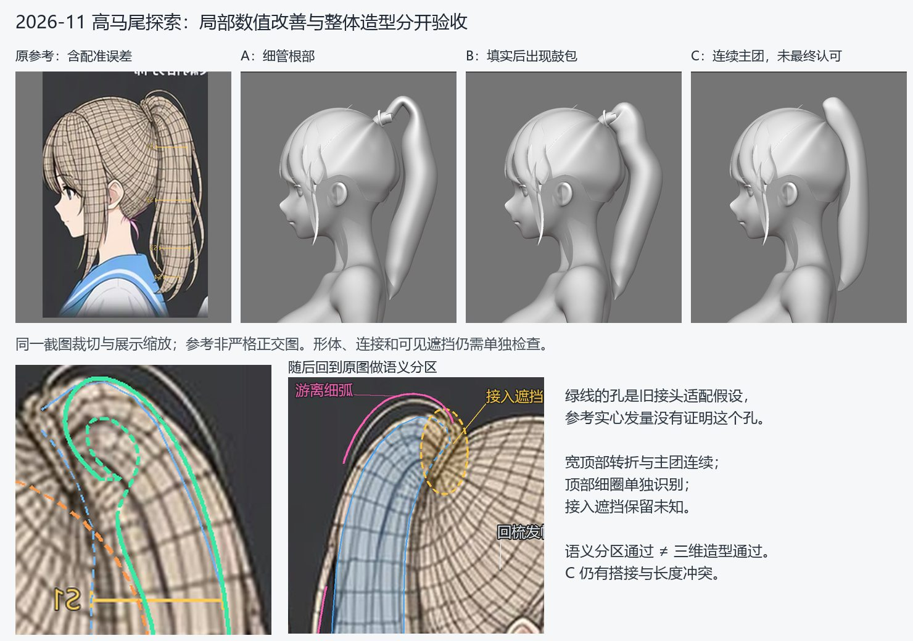

# 二次元高马尾探索：局部有效与失败教训

实践日期：2026-11-19；归档复核：2026-11-28。用户对整体效果仍不满意。可复用判断见[二次元网格头发流程](anime-mesh-hair.md)。本案例不构成成功还原教程，也不说明某模型、参数或商业插件一定能解决发型。

## 输入、环境与目标

现场为 Blender 5.2.4 LTS，经本地 MCP 操作既有角色与多层网格头发。历史端口 9875、对象 `PONY01 | 05 马尾连续主量` 与工程版本 2–6 只用于定位记录，后续执行前重新确认文件、单位与对象。

参考为 AI 设计/线框板，上方含正面、近侧面、背面及斜视；下方 V01/V02 是旧模型对照，不是新发型目标。它既不是四张严格正交图，也不是经过验证的网格拓扑。初查头发约 36 件，19,048 基础顶点、297,222 求值顶点；面数增加不是当时大形差异的直接解法。

用户允许修形或独立重建，保留已有头部/身体与旧工程；本轮由指导聊天定目标、执行聊天建模再反馈。这个分工帮助隔离艺术判断与技术实现，但错误的指导约束同样会导致失败，不记录为模型能力比较结论。

## 已做尝试与结果

| 路线 | 实际状态 | 观察、局部收益与限制 |
| --- | --- | --- |
| B1：旧马尾中段 X 位移，根尾固定 | 已运行；数值局部有效，整体外形仍未满意 | 8 件主量/随动层共用细分后的形变节点，最大横移 31 mm。末版延长上下过渡，保留基础网格和端区；中段偏轴测量减少，但指导审阅仍见中段/下段反向侧摆。只追中心回正并不代表参考流向正确。 |
| 31→22 mm 的预测线 | 仅提出，随后撤回；未生成或验收该候选 | 预测改变单参数影响，没有充分定义参考目标。用户指出青线也不像参考。不能保存为已成功的微调策略或复用该数值。 |
| A：独立截面主团 | 已运行；背面主量局部有效，根部/侧面未达标 | 514 基础顶点、实时细分 1，9 个关键截面（包含技术支撑）。背面较直下垂与中下段保量获用户初步认可；上段偏后、根部像细管拱环、末梢圆厚。根部紧弯曾自交，增加支撑及限制厚度后技术修复；这没有解决根部造型。 |
| B：填实根部并前移上段，保留 A 中下段 | 已运行；局部指标改善，指导明确不采用 | 改为不对称 D/楔形内面，上段前移，根顶降低。S1 配准中心差约 80.9→51.2 px；人体与支撑层分开检查，中下段确实保持。侧面却出现“鼓起—收腰—再鼓起”，用户感觉越来越怪。填孔、前移上段、冻结相邻中段的组合需要整体复核。 |
| 完整侧面绿色目标线 | 仅二维绘图，未用于新建网格；指导不通过 | 混合参考包络、A 接头、人体避让及 A 长度。在参考实心根部画出小孔，末端因旧长度延长约 32 px。外侧与上一份人工包络接近不证明参考结构识别正确。 |
| 回到原图做语义分区 | 已执行；语义阶段获指导认可 | 连续宽根部/主团、顶部细圈、接入遮挡及归属不明旁束分开；不引入 A/B 或人体适配。手工填色不是精确掩膜，识别认可不证明随后三维体积正确。 |
| C：按分区重建连续闭合主量 | 已运行；几何/保存检查通过，整体造型尚未获满意验收 | 15 环×14 点及真实尖端，211 基础顶点/211 面，实时细分 2；解除旧扎点、根高和长度继承。人体局部穿插通过调整 15 个内侧控制点修复；没有误建拱环孔。仍存在较大隐藏搭接、主末梢偏离及背/侧长度冲突，不能称最终发型通过。 |
| 曲线截面、Lattice、Hair Tool 引导网格/Prism Profile、Blender Studio 网格头发 | 仅调研具体公开方法；未在本任务实测这些替代路线 | 可借鉴少量控制与主量驱动层关系。课程只读公开说明，视频未完整观看；Hair Tool 未安装/试用，Lattice 未作为本轮替代系统实施。 |

## 本轮纠正与未解决问题

**参考语义与目标循环。** 指导最初把“根部回弯”表述为环形结构，又要求填实空隙，执行随后从 A 的接头倒推出参考内缘。后来的绿线仍包含旧模型适配假设，直到在原图独立分区才拆开。可确认的是这次孔的来源错误；不是所有发型都应无孔，也不是所有线框参考都不可用。

**保护要求的来源。** 保留旧模型与在新候选中继承旧锚点是两回事。A/B 的旧扎点、根高、端点和冻结区属于阶段约束，后续 C 在授权范围内解除。用户真正明确保护的锚点不能因这种教训被擅自移动。

**碰撞解释。** A 将真实人体、顶冠支撑和回梳层一起做后向投影检查，过早把上段偏后归因头型。B 改为区分实际人体入/出表面与薄头发层；局部 S1 的参考内缘确实落入人体区间，但该局部事实不能作为整团后移理由。隐藏搭接可用，需要核对真实交叉和可见接缝。

**C 的具体边界。** 执行报告记录支撑层交叉候选约 860 对、覆盖较长上段，不能描述为小扎点处的少量搭接。叠图蓝线是完整 C 网格投影，含被发帽遮挡的内面；最终可见轮廓还需单独比较。侧面主要末梢 C 高约 4.49 px、向后约 31.82 px；背面高约 43.71 px。参考背/侧端点本身约有 39.22 px 的注册高度冲突，本轮选择侧面末梢高度；该选择并非通用优先级。

**版本显示。** A/B 对照对象实际正确；A 保持证据及截图库支持这一点。工程曾恢复旧马尾显示、隐藏最新候选，用户因此难以判断当前版本。后续改为默认展示最新候选，并标清对象/工程版本。C 的对照还隐藏旧 04 接头，图中保留的顶部细弧来自旧呆毛，不能把所有可见部件算作 C 新增内容。

图是归档时从已交付截图裁切的证据摘要：原参考仅作观察；A/B/C 来自原固定侧相机，展示缩放相同。根部绿色孔来自旧方案，不是参考中已证实的孔。此图不能替代原分辨率报告或三维穿插检查。

## 已验证范围与证据来源

归档时重新读取执行报告并查看 A/C、C 参考叠图；没有在本轮重新运行 Blender、生成候选或重做全部 QA。下列数值为历史记录，存在与可读不等于独立复验。当前总体不满意的判断来自用户反馈。

历史证据根目录是执行聊天 `Blender-MCP1` 对应的 `hair-*-2026-11-19` 交付目录；工作目录或缓存可清理，后续先检查来源。本仓库保留上述紧凑图和本次筛选结论，不收存整套用户工程、原始大图或现场脚本。

- `hair-b1-2026-11-19/B1_修改记录.md`、`apply-result.json`、`reopen-result.json`：实际位移范围、端区保护及保存；全面层间贴面/浮动检查曾因三角面预算跳过。
- `hair-trial-a-2026-11-19/马尾主团A-执行反馈.md`、`reference-registration.json`、固定三视图：A 的控制与根部自交修复；人工头部配准残差约背面 5.6 px、侧面 9.2 px，锚点自身有辨认误差。
- `hair-trial-b-2026-11-19/马尾主团B-执行反馈.md`、`S1-真实人体限制.json`、`before-state.json`/`after-state.json`：B 的局部改善、实体限制与 A 保持。
- `hair-side-target-2026-11-19/侧面目标-交付说明.md`、`侧面目标轮廓-方案.json`；`hair-reference-zones-2026-11-19/参考分区-交付说明.md`：被撤回二维假设和随后语义纠正。
- `hair-trial-c-2026-11-19/马尾主团C-执行反馈.md`、`self-and-attachment-checks.json`、`geometry-verification.json`、`reopen-verification.json`：C 的实际构造、穿插修复、搭接和残差。
- 指导工作区 `work/hair_helper_validation.json`：个人截面放样助手只在隔离 Blender 验证尖端/平端、闭合、非零体积、输入/同名拒绝和原对象保留。它未证明复杂根部自交可自动解决或参考重建质量。

先前另有用户级 `blender-anime-mesh-hair` 试验技能与助手。本仓库没有复制一套完整独立实现，也没有修改它的安装；当前入口维护可复用判断，旧脚本以本段作为历史线索，需要使用时另核对可用性和适用范围。

## 再探索条件与停止标准

重试前确认部件分区、旧模型保护条件及注册冲突，选一个明确待验证问题。值得验证的路线包括非椭圆根部控制面、协调整个前后包络、主团认可后派生次级束，以及将可见遮挡轮廓与隐藏内面投影分别量化；这些尚未完成跨发型验证。

每轮保留可回退候选，核对原参考而非只对上一条人工线拟合。若小指标改善却出现更明显鼓包、错误孔或连接节奏，不以数值收敛接受；回查识别和约束组合。没有新增输入或方法，不原样重跑单横移、填孔再固定中段或旧绿色轮廓。

## 调研来源

2026-11-19 阅读公开资料：[Blender 5.2 曲线几何](https://docs.blender.org/manual/en/5.2/modeling/curves/properties/geometry.html)、[Curve 修改器](https://docs.blender.org/manual/en/5.2/modeling/modifiers/deform/curve.html)、[Lattice](https://docs.blender.org/manual/en/5.2/modeling/modifiers/deform/lattice.html)、[Blender Studio Hair Retopology](https://studio.blender.org/training/stylized-character-workflow/9-hair-retopology/)、Hair Tool 的 [Grid Surface](https://joseconseco.github.io/HairTool_3_Documentation/main_workflows/hair_from_surface.html)、[Prism Profile](https://joseconseco.github.io/HairTool_3_Documentation/main_workflows/strands_from_prism_profile.html) 与 [Guide Mesh](https://joseconseco.github.io/HairTool_3_Documentation/main_workflows/hair_with_track_mesh.html)。本次归档没有重新联网核对或安装插件，不宣称它们已验证当前发型。
